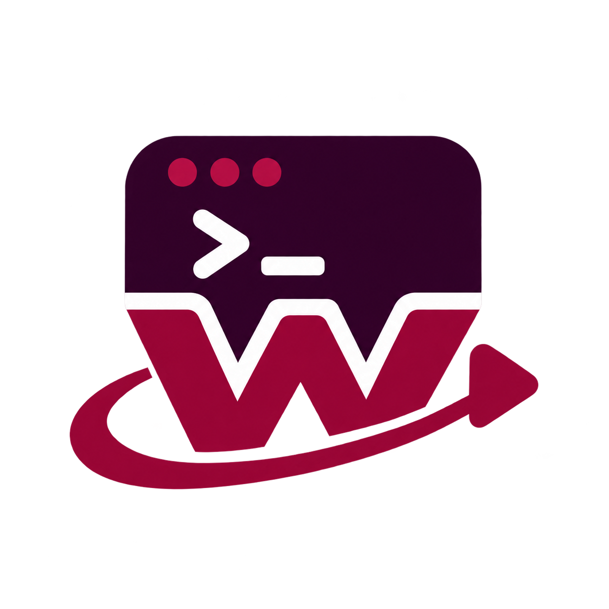

<p align="center">
  
</p>

<h1 align="center">WUR</h1>

<p align="center">
  <strong>Wine Unified Runner</strong><br />
  A portable command-line workflow for running Windows games on Linux and macOS.
</p>

<p align="center">
  <a href="https://github.com/Gr3gorywolf/proton-cli-launch/releases"></a>
  <a href="https://github.com/Gr3gorywolf/proton-cli-launch/commits/main"></a>
  <a href="./LICENSE"></a>
  
  
</p>

## Overview

WUR turns the usually manual process of running Windows games through Wine or Proton into a repeatable CLI workflow. It downloads and manages compatible runtimes, creates isolated Wine prefixes, installs graphics and anti-cheat components, and launches each game with the right environment—all without requiring a graphical launcher.

Every game can have its own reproducible **container** while still sharing one portable Windows user profile for saves, documents, and application data. The complete installation can stay beside the WUR binary or be moved to a custom directory, making it practical for external drives, handhelds, scripts, and launcher integrations.

WUR follows the runtime providers, asset selection, prefix preparation, and launch behavior used by [Heroic Games Launcher](https://github.com/Heroic-Games-Launcher/HeroicGamesLauncher) 2.22.4, packaged as a focused standalone tool.

## Contents

- [Features](#features)
- [Platform support](#platform-support)
- [Installation](#installation)
- [Quick start](#quick-start)
- [How WUR works and command reference](#how-wur-works-and-command-reference)
- [Runtime and component catalog](#runtime-and-component-catalog)
- [Container workflows](#container-workflows)
- [Game override workflow](#game-override-workflow)
- [Declarative container manifests](#declarative-container-manifests)
- [Portable data](#portable-data)
- [JSON output and automation](#json-output-and-automation)
- [Build from source](#build-from-source)
- [Download integrity](#download-integrity)
- [License and attribution](#license-and-attribution)

## Features

- **Unified runtime management** — Browse, install, replace, and remove supported Wine, Proton, CrossOver, and Game Porting Toolkit builds through one consistent command set.
- **Automatic environment preparation** — WUR installs a missing runtime on first use, initializes the Wine prefix, applies compatible DLL components, and prepares the launch environment before the game starts.
- **Isolated game containers** — Keep runtime versions, prefix architecture, components, and launch settings separate for each game or use case.
- **Declarative configuration** — Rebuild complete containers from small `config.json` manifests, making setups easy to reproduce and version-control.
- **Per-game overrides** — Place a commented `wur-overrides.jsonc` beside a game to change its container, components, environment variables, or launch options without modifying the base container.
- **Managed compatibility components** — Install DXVK, DXVK-NVAPI, VKD3D-Proton, DXVK for macOS, Easy Anti-Cheat, BattlEye, and other supported runtime components.
- **Shared portable Windows profile** — All prefixes expose the same `C:\users\user`, so saves, Documents, AppData, and similar data remain available when switching containers or runtimes.
- **Windows redistributable setup** — Download, cache, and run the interactive All-in-One Runtime Installer inside a selected container.
- **Launcher-friendly output** — Use human-readable terminal output interactively or `--json`/JSON Lines for scripts, frontends, and download progress tracking.
- **Clean process lifecycle** — Each launch runs in its own process group. WUR shuts down the game tree and its Wine server when the process exits or the CLI receives a termination signal.
- **Portable standalone binary** — Build a single executable with Node.js embedded; the destination computer does not need Node.js installed.

## Platform support

| Host platform | Supported runtime sources | Platform default |
| --- | --- | --- |
| Linux | GE-Proton, Valve Proton, Proton Archive, Proton-CachyOS, Wine-Lutris | GE-Proton |
| macOS Apple Silicon | Wine-CrossOver, Wine Staging, Game Porting Toolkit | Wine-CrossOver |
| macOS Intel | Wine-CrossOver, Wine Staging | Wine Staging |

Game Porting Toolkit requires Apple Silicon and macOS Sonoma or newer. Runtime and component compatibility is checked before installation or launch. Use `--all` only when you want to inspect the complete cross-platform catalog.

## Installation

### Download a release

Download the package for your platform from the [Releases page](https://github.com/Gr3gorywolf/proton-cli-launch/releases). Keep `wur`, `defaults.json`, and `wur-overrides.template.jsonc` together in a directory where WUR can store its portable state, then make the binary executable when necessary:

```sh
chmod +x wur
./wur --help
```

You may keep using `./wur` or move the executable's directory into your `PATH`.

### Install from source

WUR requires Node.js 18 or newer, npm, `tar`, and `unzip` when running from source:

```sh
git clone https://github.com/Gr3gorywolf/proton-cli-launch.git
cd proton-cli-launch
npm ci
npm run build
npm link
wur --help
```

If you do not want to create a global npm link, run the compiled CLI directly:

```sh
node dist/src/cli.js --help
```

See [Build from source](#build-from-source) for validation commands and standalone binary builds.

## Quick start

Getting started takes only two commands:

```sh
# Run this once during the initial setup.
wur install-recommended

# Then launch any Windows game.
wur run "/games/My Game/Game.exe"
```

**That's it—two commands.** You only need to run `install-recommended` the first time you set up WUR. From then on, use `wur run` whenever you want to launch a game; WUR creates and prepares the default container automatically.

The `run` keyword is optional when the first argument is an existing Windows-launchable file:

```sh
wur "/games/My Game/Game.exe" --container my-game -- -windowed
```

WUR recognizes the standard Windows `PATHEXT` formats (`.com`, `.exe`, `.bat`, `.cmd`, `.vbs`, `.vbe`, `.js`, `.jse`, `.wsf`, `.wsh`, `.msc`) plus `.pif`, `.scf`, and `.scr`. Place arguments intended for the Windows program after `--`.

## How WUR works and command reference

WUR is built around four core ideas: a **runtime** provides the Wine or Proton compatibility layer, **components** add optional compatibility capabilities, a **container** keeps one isolated Windows environment, and a **game override** adjusts that environment for one executable. The following sections explain each part and place its commands directly beside it.

All paths containing spaces should be quoted. Options marked as repeatable may be supplied more than once.

### Basic workflow

Most users only need `install-recommended` once and `run` afterward. The remaining commands help inspect recommendations, get command-specific help, or customize the launch.

| Command | Purpose | Example |
| --- | --- | --- |
| `wur --help` | Show the complete CLI help. | `wur --help` |
| `wur help <command>` | Show help for a command group or subcommand. | `wur help container` |
| `wur suggest` | Show platform-compatible runtime and component recommendations. | `wur suggest --json` |
| `wur install-recommended [--dry-run] [--force]` | Install the runtime and components enabled in `config/defaults.json`; `--dry-run` only prints the plan. | `wur install-recommended --dry-run` |
| `wur run <executable> [arguments...]` | Launch a Windows program with the default or selected container. Supports `--container <name>` and `--cwd <directory>`. | `wur run game.exe --container game -- -windowed` |
| `wur <executable> [arguments...]` | Shortcut for `wur run` when the file already exists. | `wur game.exe -- --safe-mode` |

### Runtimes

A **runtime** is the compatibility engine that actually executes Windows software. Depending on the host, this can be a Proton build, Wine, Wine-CrossOver, or Game Porting Toolkit. Containers reference a runtime by source and version, while WUR handles downloading it, locating it, and selecting the correct launch behavior.

You normally do not need to choose one manually: `install-recommended` installs the platform default, and a missing runtime is installed automatically when its container is prepared. The runtime commands are useful when you want a specific provider or version.

| Command | Purpose | Example |
| --- | --- | --- |
| `wur runtime list` | List locally installed runtimes. Filter with `--source <source>`. | `wur runtime list --source ge-proton` |
| `wur runtime list --remote` | List remote releases. Supports `--source`, `--limit <number>`, and `--all`; `--available` is an alias for `--remote`. | `wur runtime list --remote --source wine-lutris --limit 10` |
| `wur runtime install [source] [version]` | Install a runtime. Omitting the source selects the platform default; the version defaults to `latest`. Use `--force` to replace it. | `wur runtime install ge-proton latest` |
| `wur runtime remove <source> [version]` | Remove a managed runtime; `delete` is an alias. | `wur runtime remove ge-proton latest` |

### Components

**Components** are optional compatibility building blocks installed alongside a runtime. They provide features such as Direct3D translation through DXVK or VKD3D, NVIDIA NVAPI support, and anti-cheat runtime files. WUR installs the components enabled by your defaults or container and applies only those that the selected runtime can use.

Some runtimes already include their own graphics stack. Their metadata tells WUR which components to ignore, preventing an incompatible DLL from being injected into the prefix.

| Command | Purpose | Example |
| --- | --- | --- |
| `wur component list` | List locally installed components. | `wur component list` |
| `wur component list --remote` | List available releases. Supports `--name`, `--limit <number>`, and `--all`; `--available` is an alias for `--remote`. | `wur component list --remote --name dxvk --limit 10` |
| `wur component install <name> [version]` | Install a component; the version defaults to `latest`. Use `--force` to replace it. | `wur component install vkd3d latest` |
| `wur component remove <name> [version]` | Remove a managed component; `delete` is an alias. | `wur component remove vkd3d latest` |

### Containers

A **container** is an isolated Windows environment for a game or tool. It combines a Wine prefix with a selected runtime, component versions, architecture, environment variables, and launch settings. Containers prevent one game's configuration from affecting another while the shared portable Windows profile keeps saves and user data available across them.

The first `wur run` creates a container named `default` when none exists. Create additional containers when a game needs a different runtime or specialized settings.

| Command | Purpose | Example |
| --- | --- | --- |
| `wur container list` | List containers, their runtimes, prefix paths, initialization state, and the current default. | `wur container list` |
| `wur container create [name]` | Create and initialize a container. Supports `--runtime <source/version>`, repeatable `--component <name=true\|false>`, repeatable `--set <path=value>`, and `--no-initialize`. | `wur container create game --runtime ge-proton/latest --component vkd3d=true` |
| `wur container show [name]` | Show a container's complete validated configuration; also accepts `--name`. | `wur container show game --json` |
| `wur container configure [name]` | Change one or more validated settings with repeatable `--set <path=value>`. | `wur container configure game --set launch.showFps=true` |
| `wur container default [name]` | Show the current default when no name is given, or select a new default. | `wur container default game` |
| `wur container remove [name]` | Remove a managed container and its prefix; `delete` is an alias. | `wur container remove game` |
| `wur container install-redist [name]` | Download or reuse the cached Windows redistributable bundle and run its interactive installer. | `wur container install-redist game` |
| `wur container exec <program> [arguments...]` | Run a Windows executable or Wine built-in inside a prepared container. Supports `--name` and `--cwd`. | `wur container exec winecfg --name game` |
| `wur build [name]` | Build one or all container manifests found under `containers/*/config.json`; also accepts `--name <name>`. | `wur build my-game` |

### Game overrides

A **game override** is a `wur-overrides.jsonc` sidecar stored beside a Windows executable. It changes the selected container, component versions, launch flags, or environment variables for that game only. This is useful when several games can share a container but one of them needs a small exception.

Overrides are applied in memory for the launch and never rewrite the container. The generated JSONC template includes comments and every supported property.

| Command | Purpose | Example |
| --- | --- | --- |
| `wur override <executable>` | Show an executable's current override values without creating a sidecar. | `wur override game.exe` |
| `wur override show <executable>` | Explicit form of `wur override <executable>`. | `wur override show game.exe` |
| `wur override set <executable>` | Create the commented sidecar and optionally change values with repeatable `--val <path=value>`. | `wur override set game.exe --val launch.showFps=true` |
| `wur override delete <executable>` | Delete only the executable's `wur-overrides.jsonc` sidecar. | `wur override delete game.exe` |

### Defaults and storage

**Defaults** are the platform-aware template used whenever WUR creates a new container. Changing them affects future containers without rewriting existing ones. The **WUR home** is the directory that holds containers, runtimes, components, downloads, configuration, and the shared Windows user profile.

By default, the WUR home stays beside the compiled distribution or standalone binary. You can point it to an existing writable directory when you want the data on another disk or in a launcher-managed location.

| Command | Purpose | Example |
| --- | --- | --- |
| `wur defaults show` | Show the platform-aware template used by new containers. | `wur defaults show --json` |
| `wur defaults set` | Change the template with repeatable `--set <path=value>`. | `wur defaults set --set runtime.source=wine-lutris` |
| `wur home show` | Show the active persistent state directory. | `wur home show` |
| `wur home set <directory>` | Select an existing writable directory for persistent state. | `wur home set /mnt/games/wur-data` |

### Machine-readable output

`--json` can be used with commands that return data:

```sh
wur runtime list --json
wur container show game --json
wur suggest --json
```

## Runtime and component catalog

### Runtime catalog

| Source ID | Runtime | Host |
| --- | --- | --- |
| `ge-proton` | GE-Proton | Linux |
| `proton` | Valve Proton | Linux |
| `proton-archive` | Historical official Proton builds from Kron4ek's archive | Linux |
| `proton-cachyos` | Proton-CachyOS | Linux |
| `wine-lutris` | Wine-Lutris | Linux |
| `wine-crossover` | Wine-CrossOver | macOS |
| `wine-staging-macos` | Wine Staging builds by Gcenx | macOS |
| `game-porting-toolkit` | Apple's Game Porting Toolkit builds packaged by Gcenx | macOS Apple Silicon |

Each runtime declares the components it owns or cannot accept. WUR skips incompatible DLL injection automatically; for example, Proton and CrossOver keep their own graphics stacks untouched.

### Component catalog

| Component ID | Purpose | Typical host |
| --- | --- | --- |
| `dxvk` | Direct3D 9/10/11 translation for Wine prefixes. | Linux |
| `dxvk-nvapi` | NVIDIA NVAPI support through DXVK. | Linux with a supported NVIDIA driver |
| `vkd3d` | Direct3D 12 translation through VKD3D-Proton. | Linux |
| `dxvk-macos` | DXVK build for compatible Wine Staging prefixes. | macOS |
| `dxmt` | Experimental Direct3D-to-Metal component; downloaded for manual experimentation and not injected automatically. | macOS |
| `eac-runtime` | Easy Anti-Cheat runtime exposed to compatible Proton launches. | Linux |
| `battleye-runtime` | BattlEye runtime exposed to compatible Proton launches. | Linux |
| `umu` | Optional Steam Runtime launcher integration files. | Linux |

On macOS, a container's generic `dxvk` selection is resolved to `dxvk-macos`. `wur suggest` is the safest way to see what applies to the current machine.

## Container workflows

A container is a validated configuration plus an isolated Wine prefix under `containers/<name>/`. It records only portable declarations—such as runtime source and version—not machine-specific runtime paths.

Create a customized container:

```sh
wur container create cyberpunk \
  --runtime ge-proton/latest \
  --component dxvk-nvapi=true \
  --set launch.enableWayland=true \
  --set launch.showFps=true
```

Inspect it, make it the default, and launch a game:

```sh
wur container show cyberpunk
wur container default cyberpunk
wur run "/games/Cyberpunk 2077/bin/x64/Cyberpunk2077.exe"
```

Useful built-in tools can be started without launching a game:

```sh
wur container exec explorer.exe --name cyberpunk
wur container exec regedit.exe --name cyberpunk
wur container exec winecfg --name cyberpunk
wur container exec dxdiag.exe --name cyberpunk -- /t dxdiag.txt
```

Wine includes `dxdiag.exe` for DirectX diagnostics. OpenGL and Vulkan tools are not bundled; install or provide a compatible Windows utility such as `glview.exe`, `vkcube.exe`, or `vulkaninfo.exe` before running it with `container exec`.

### Windows redistributables

```sh
wur container install-redist --name cyberpunk
```

WUR checks the latest [All-in-One Runtime Installer](https://github.com/BloopSmasher/All-in-One-Runtime-Installer) release, reuses a matching extracted copy from `redist/`, or downloads and caches a new one. It then runs the upstream interactive `All in One Runtime Installer (AutoAdmin).bat` inside the container. The installer includes its own confirmation and reboot prompt; choose **N** to defer the reboot.

## Game override workflow

On the first launch—or when `wur override set` is used—WUR places a documented `wur-overrides.jsonc` beside the Windows executable. JSONC supports `//` comments, and the generated template lists every valid setting.

```jsonc
{
  "containerName": "cyberpunk",
  "components": {
    "dxvkNvapi": { "enabled": true, "version": "latest" }
  },
  "launch": {
    "enableHdr": true,
    "showFps": true,
    "environment": {
      "WINEDEBUG": "-all"
    }
  }
}
```

Manage the sidecar from the CLI:

```sh
# Show current values. A missing sidecar returns {} and is not created.
wur override show "/games/My Game/Game.exe"

# Create the template and set validated values.
wur override set "/games/My Game/Game.exe" \
  --val containerName=my-game \
  --val launch.showFps=true \
  --val launch.environment.DXVK_ASYNC=1

# Remove one value by assigning an empty value.
wur override set "/games/My Game/Game.exe" --val launch.showFps=

# Delete the complete sidecar.
wur override delete "/games/My Game/Game.exe"
```

Use the complete property path shown in the template. Short aliases such as `enableHdr` or `version` are rejected. `--container <name>` on `wur run` takes precedence over `containerName`, but all component, launch, and environment overrides still apply. Overrides affect only that launch and never rewrite `container.json`.

## Declarative container manifests

Create `containers/<name>/config.json` with only the settings that differ from the defaults:

```json
{
  "runtime": {
    "source": "wine-lutris",
    "version": "latest"
  },
  "components": {
    "dxvk": { "enabled": true }
  },
  "launch": {
    "enableWayland": true,
    "environment": {
      "WINEDEBUG": "-all"
    }
  }
}
```

Build one manifest or every manifest found under `containers/`:

```sh
wur build my-game
wur build
```

WUR fills missing fields from `config/defaults.json`, writes the complete `container.json`, installs the required runtime and components, initializes the prefix, and selects the first container as the default when no default exists.

The defaults used by future containers can be inspected and changed independently:

```sh
wur defaults show
wur defaults set --set runtime.source=wine-lutris
wur defaults set --set launch.verboseLogs=true
```

Values are parsed as JSON when possible, so booleans, numbers, and `null` keep their native types.

## Portable data

By default, WUR stores all managed state beside the compiled distribution or standalone binary:

```text
release/
├── wur
├── defaults.json
├── wur-overrides.template.jsonc
├── config/
│   ├── config.json
│   └── defaults.json
├── user/
│   ├── AppData/
│   ├── Documents/
│   └── Saved Games/
├── runtimes/
├── components/
├── redist/
├── downloads/
└── containers/
    └── my-game/
        ├── container.json
        └── prefix/
```

Every prefix links `C:\users\user` to the shared `user/` directory. This keeps Windows profile data available across containers without pointing Wine's standard folders at the host user's home directory.

To keep persistent state somewhere else, first create a writable directory and select it:

```sh
mkdir -p /mnt/games/wur-data
wur home set /mnt/games/wur-data
wur home show
```

The absolute selection is stored in `config/config.json` beside the executable, allowing WUR to find the external state directory on future runs.

## JSON output and automation

Commands that return lists or structured values support `--json`. Standard results are written to stdout as one JSON document; an empty list is `[]`.

Listings return an array. For example, containers and installed components return:

```jsonc
// wur container list --json
[
  {
    "name": "cyberpunk",
    "runtime": "ge-proton/latest",
    "default": true,
    "initialized": true,
    "prefix": "/portable/wur/containers/cyberpunk/prefix"
  }
]

// wur component list --json
[
  {
    "name": "dxvk",
    "version": "latest",
    "path": "/portable/wur/components/dxvk/latest",
    "installedAt": "2026-11-06T12:00:00.000Z"
  }
]
```

Installations use **JSON Lines** so callers can display live progress:

```json
{"name":"dxvk","progress":0}
{"name":"dxvk","progress":100}
```

Errors use one JSON object and WUR exits with a non-zero status:

```json
{"error":"Download failed (404) for https://example.invalid/component.tar.xz"}
```

Commands such as `container install-redist`, `run`, and `container exec` also return JSON when requested, including their relevant paths, cache details, or process exit result.

Colors are disabled automatically when output is redirected or when the `NO_COLOR` environment variable is set.

## Build from source

### Requirements

- Linux or macOS
- Node.js 18 or newer and npm
- Git
- `tar` and `unzip`
- Internet access for dependencies, runtime catalogs, and managed downloads
- Xcode Command Line Tools when producing the universal standalone binary on macOS (`codesign` and `lipo` are used)

### Development build

```sh
git clone https://github.com/Gr3gorywolf/proton-cli-launch.git
cd proton-cli-launch
npm ci
npm run build
node dist/src/cli.js --help
```

Run the formatter check, TypeScript validation, and test suite before contributing:

```sh
npm run check
npm test
```

Available development scripts:

| Script | Description |
| --- | --- |
| `npm run build` | Compile TypeScript into `dist/` and copy the bundled defaults and override template. |
| `npm start -- --help` | Run the compiled CLI with source maps enabled. |
| `npm run check` | Check formatting and TypeScript types without emitting files. |
| `npm run format` | Format the repository with Biome. |
| `npm test` | Build the project and execute the Node.js test suite. |
| `npm run build-binary` | Produce a standalone executable for the current host platform. |

### Standalone binary

```sh
npm ci
npm run build-binary
./release/wur --help
```

The build embeds Node.js and creates `release/wur` for the current platform. On macOS, it produces an ad-hoc-signed universal arm64/x86_64 binary; on Linux, it targets the current architecture. The required `defaults.json` and `wur-overrides.template.jsonc` files are copied beside the executable.

Normal builds replace only the executable and preserve the portable state already stored in `release/`. To intentionally recreate the entire release directory:

```sh
npm run build-binary -- --clean
```

> [!WARNING]
> `--clean` removes the complete `release/` directory, including any containers, runtimes, components, and user data stored there. Back up anything you need first.

The build downloads official Node.js archives, verifies them against `SHASUMS256.txt`, and caches them under `.cache/node-binaries/`. Override the pinned build runtime only when necessary:

```sh
WUR_NODE_VERSION=22.23.4 npm run build-binary
```

## Download integrity

Runtime and component release metadata comes from the upstream GitHub and Lutris APIs used by Heroic. GE-Proton and Proton-CachyOS assets are verified with SHA-512 when the release publishes a checksum. Archives are extracted into a temporary staging directory and moved into managed storage only after extraction succeeds.

## License and attribution

WUR is released under the [MIT License](./LICENSE).

Its runtime providers, Wine/Proton builds, components, and redistributable installers remain subject to their own licenses. WUR is an independent project and is not affiliated with WineHQ, CodeWeavers, Apple, Valve, Heroic Games Launcher, or any runtime or component provider.
